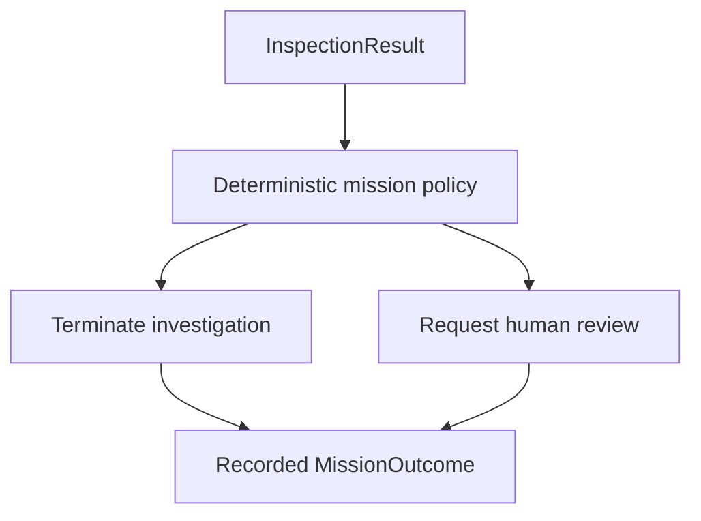

# Week 6 — Mission Decisions and Outcome Handling

## Objective

Extend the active-inspection capability completed in Week 5 so that an `InspectionResult` leads to a clear, reproducible mission response.

By the end of Week 6, the system should consume a completed or failed inspection result, apply a deterministic policy, produce a structured `MissionOutcome`, and preserve that outcome alongside its evidence and execution trace.

The Week 6 milestone is:

> **An inspection result produces an explicit mission response, with the reason and evidence available for review.**

The first policy will end investigations with no qualifying smoke observation and request human review for smoke observations or failed inspections. It will not claim to distinguish acceptable campfires from dangerous fires.

“Week” continues to name a work milestone rather than a required seven-day duration. Calendar targets below govern the submission schedule.

---

## Week 5 Closeout — October 12, 2026

Week 5's functional milestone has been demonstrated on the live simulator.

The project can now:

- accept an `InspectionRequest` and resolve its logical search region;
- dispatch the drone to a predefined NED target;
- confirm arrival within the configured per-axis tolerance;
- request a fresh RGB camera callback after arrival;
- save the newly acquired drone image;
- reuse the existing smoke detector on the saved evidence;
- produce a validated `InspectionResult` with the request's identifier;
- represent positive, negative, and failed inspection outcomes separately;
- save a JSON trace linking the monitoring event, request, dispatch, and inspection;
- return home, land, and disconnect after the live inspection.

### Verified Live Run

| Item | Recorded result |
| --- | --- |
| Inspection ID | `inspection_988cb783` |
| Monitoring trigger | Synthetic `MonitoringEvent` |
| Inspection evidence | Actual Project AirSim `DownCamera` imagery |
| Requested NED target | `(5.0, 10.0, -5.0)` |
| Actual position, rounded | `(5.00, 9.98, -5.54)` |
| Arrival tolerance | `1.0` meter per axis |
| Inspection completed | `True` |
| Smoke reported | `True` |
| Model confidence | Approximately `0.659` |
| Cleanup | Return-home, landing, and disconnect completed |

The scene contained no intended smoke event. Treat the positive prediction as a **known false positive** and retain its PNG and JSON trace.

This establishes pipeline functionality while exposing a perception limitation. Model quality has not been comprehensively evaluated. Controlled local checks covered negative results and operational failures; this live run did not establish a correct negative prediction.

### Week 5 Closure Record

- [x] Concrete `InspectionResult` implemented and validated.
- [x] Fresh-frame capture tested on the live simulator.
- [x] Full arrival-to-evidence-to-perception flow tested live.
- [x] Evidence and request provenance preserved.
- [x] Return-home and landing demonstrated.
- [x] Known false positive identified for evaluation.
- [x] Add the updated `interfaces.md` and this setup document to the repository.
- [x] Confirm the live-run image and trace remain available and record their paths in the PR.
- [x] Commit, review, and merge the Week 5 changes.

Week 5 changes were reviewed and merged into main in PR #9 on October 13, 2026.

---

## Week 6 Implementation Checkpoint — October 13, 2026

The local implementation now includes:

- a validated, frozen `MissionOutcome` and JSON serialization;
- `evaluate_inspection()` with deterministic positive, negative, and failed-inspection responses;
- outcome recording in the existing `scripts/test_active_inspection.py` flow;
- local review messages with identifiers, reasons, evidence, and trace paths;
- separate cleanup status/errors saved in the final trace;
- fifteen passing controlled tests, including the four required inspection fixtures and operational-failure handling;
- updated `interfaces.md` documenting the implemented contracts.

The controlled tests use synthetic inputs and temporary evidence. They do not demonstrate detector accuracy or live flight behavior.

Run the controlled suite from the project root:

```powershell
python -m scripts.test_mission_outcome
```

Then, with Blocks running and `ROBOFLOW_API_KEY` configured in the existing environment:

```powershell
python -m scripts.test_active_inspection
```

**Remaining closeout:** inspect the live PNG and JSON trace, verify that `outcome` matches `inspection`, confirm `cleanup.completed=true` and an empty cleanup error list, and retain the new run evidence. A positive detector observation should request review even if the scene contains no intended smoke. The known Week 5 false-positive evidence remains part of evaluation and must be retained.

Week 6 is not marked complete until this live check and change review are finished.

---

## Week 6 System Boundary

Week 6 adds decision and outcome recording to the existing inspection flow.



The decision layer consumes project-owned inspection data. It does not call Roboflow, subscribe to cameras, or issue flight commands.

Flight cleanup remains required for every branch. A decision to terminate an investigation does not replace return-home and landing. A human-review outcome does not mean the drone should remain airborne awaiting a person.

---

## Goal 1 — Implement a Minimal `MissionOutcome`

Finalize the future interface in `interfaces.md` and implement it under `src/mission/`.

The implemented initial representation is:

```python
MissionOutcome(
    inspection_id="inspection_988cb783",
    decision="request_human_review",
    reason="smoke_observed",
)
```

| Proposed field | Purpose |
| --- | --- |
| `inspection_id` | Preserve the association with `InspectionResult` and its trace |
| `decision` | Explicit mission response: `terminate` or `request_human_review` |
| `reason` | Stable explanation: `no_smoke_observed`, `smoke_observed`, or `inspection_failed` |

These Week 6 contracts are now implemented and covered by controlled checks. The outcome validates allowed values and combinations, preserves a nonempty inspection identifier, and provides a JSON-serializable representation consistent with the existing payloads.

The result and trace already contain confidence, evidence path, and failure details. Avoid copying all of that state into the outcome. Keep the association through `inspection_id` and the complete mission trace.

Do not add delivery status, human approval status, danger classification, or database identifiers without an implemented capability requiring them.

---

## Goal 2 — Implement the Deterministic Decision Policy

Use this initial policy:

| Inspection input | Decision | Reason | Meaning |
| --- | --- | --- | --- |
| `completed=True`, `detected=False` | `terminate` | `no_smoke_observed` | End this investigation because the inspection produced no qualifying smoke prediction |
| `completed=True`, `detected=True` | `request_human_review` | `smoke_observed` | Present the smoke prediction and evidence for review |
| `completed=False`, `detected=None` | `request_human_review` | `inspection_failed` | The system could not establish an inspection observation |

The policy should be a small function or class that consumes `InspectionResult` and returns `MissionOutcome`. The same input must produce the same outcome.

### Interpretation Rules

- `no_smoke_observed` reports the model observation at its configured threshold. It does not assert that the property is safe.
- `smoke_observed` does not establish a dangerous fire. The known simulator false positive should still follow the same review policy.
- `inspection_failed` must retain uncertainty. It must never be silently treated as a negative detection.
- Confidence can be displayed in the linked inspection result. Do not introduce another confidence threshold or treat a high score as evidence of danger during this milestone.
- Do not silently fall back to `terminate` for unsupported or malformed inputs.

The policy only consumes an available `InspectionResult`. Connection, configuration, or other setup exceptions that occur before a result exists must still fail explicitly; do not invent an observation to fit the policy.

---

## Goal 3 — Record the Outcome and Human-Review Request

Extend the local mission trace to include the serialized outcome while retaining the existing request, dispatch, and inspection sections.

For a review branch, the saved record and terminal output should make clear:

- which inspection needs review;
- whether review was triggered by observed smoke or inspection failure;
- where its evidence can be opened, when evidence exists;
- where the complete trace can be found.

For Week 6, a saved local review record and clear terminal message are sufficient. `request_human_review` means the system recorded a request for review. It does not imply that an email or alert was delivered or that a person responded.

Record every outcome, including termination. Logging is common to all branches and does not need to be a separate mutually exclusive decision.

Keep files under `data/test_outputs/inspections/` and associate outcome records with the inspection identifier. A generalized evidence store or notification system is unnecessary for this boundary.

---

## Goal 4 — Integrate Decision Handling into the Live Mission

Extend the Week 5 integration flow or add one explicit Week 6 integration entry point.

The flow should:

1. Create the monitoring event and inspection request.
2. Dispatch and confirm arrival.
3. Capture, save, and analyze new drone evidence.
4. Produce `InspectionResult`.
5. Evaluate it into `MissionOutcome`.
6. Save the outcome in the mission trace and report its reason.
7. Return home, land, shut down, and disconnect.

A failed inspection can still produce an `inspection_failed` mission outcome before the integration script raises. Outcome recording must not make the underlying inspection failure disappear. Save the available trace, report the failure, and preserve cleanup.

Successful mission decisions also do not erase cleanup failures. Record cleanup errors separately and do not print an unqualified success message when landing or disconnection fails.

For the known simulator false positive, the expected policy output is:

```json
{
  "inspection_id": "inspection_988cb783",
  "decision": "request_human_review",
  "reason": "smoke_observed"
}
```

This example illustrates the proposed policy for the saved Week 5 result. A fresh integration run will generate a new inspection identifier and may produce a different detector observation.

---

## Goal 5 — Verify Each Policy Branch with Controlled Inputs

Use explicit `InspectionResult` fixtures for:

| Case | Expected policy behavior |
| --- | --- |
| Positive inspection with saved evidence | Request review for `smoke_observed` |
| Completed negative inspection | Terminate for `no_smoke_observed` |
| Capture failure without evidence | Request review for `inspection_failed` |
| Perception failure after saving evidence | Request review and preserve the evidence association |

Verify that the inspection identifier survives, reasons are stable, outcomes serialize, and trace records retain the source result.

These checks do not need AirSim or Roboflow. Do not require the live detector to produce a negative prediction before testing the negative policy branch. Controlled fixtures establish policy behavior, not model accuracy.

Then run one live mission using actual drone evidence and the existing detector. Confirm that the decision matches the observed `InspectionResult`, the trace includes the outcome, and cleanup completes.

Keep synthetic policy cases clearly identified in the test output and documentation.

---

## Definition of Done

Week 6 is complete when:

- [x] `MissionOutcome` has a concrete minimal implementation.
- [x] The deterministic policy consumes `InspectionResult` without simulator or Roboflow calls.
- [x] Positive inspection requests human review.
- [x] Negative inspection ends the investigation with an observation-specific reason.
- [x] Failed inspection requests review and remains distinct from negative detection.
- [x] Outcome identifiers match their inspection results.
- [x] Outcomes and linked evidence can be reviewed in a saved local trace.
- [x] A local review request is clearly distinguished from delivered notification or human approval.
- [x] Controlled positive, negative, and failure cases pass.
- [x] One live run demonstrates inspection-to-outcome handling.
- [x] Inspection errors still fail loudly after available outcome recording.
- [x] Return-home, landing, and cleanup remain caller-owned and verified.
- [x] `interfaces.md` describes the implemented mission interface.
- [x] The known false positive remains documented and its evidence retained.

Week 6 completion establishes deterministic mission handling. It does not establish competition submission readiness by itself.

---

## Expected Source Organization

| Path | Responsibility |
| --- | --- |
| `src/mission/mission_outcome.py` | Outcome dataclass and serialization |
| `src/mission/decision_policy.py` | Deterministic inspection-to-outcome policy |
| `src/inspection/inspector.py` | Existing evidence and observation capability |
| `scripts/test_mission_outcome.py` | Controlled policy cases; suggested filename |
| `scripts/test_mission_flow.py` | Live flow including outcome recording; suggested filename |
| `docs/interfaces.md` | Implemented subsystem contracts |

Filenames may change if an existing integration script is the cleaner place to extend the flow. Keep the responsibility boundaries intact.

---

## Explicit Non-Goals

### No Campfire/Dangerous-Fire Classification Yet

The eventual V1 scenario still includes logging acceptable campfires and escalating dangerous fires. The current `InspectionResult` contains a smoke observation rather than a fire-type classification.

Do not derive that classification from smoke confidence or insert a test-scene label as if the drone inferred it. Additional visual/context evidence and a classification capability are needed. Human review is the initial response to that unresolved distinction.

### No Detector Improvement Project

Do not train or fine-tune a model, build a dataset, or optimize detector thresholds during Week 6. Preserve the false-positive evidence and keep the detector replaceable behind `DetectionResult`.

### No New Simulation or Navigation Scope

Do not add a full property, all three cameras, smoke-world localization, search sweeps, or autonomous viewpoint selection. Continue with one predefined region and the existing Blocks environment.

### No External Notification Delivery

Do not add email, SMS, emergency-service integration, or a dashboard. Week 6 records a local human-review request. Actual delivery and human-response handling require their own explicit scope.

### No Agent or Cloud Build Inside This Milestone

First finish the deterministic policy and outcome trace. MCP tools, agent orchestration, OpenCV 5 migration, and AWS deployment belong to the next submission-focused work block. Their dates below are firm project targets rather than indefinite future work.

---

## Path to the October 26 Submission

The agreed schedule remains focused on a small, demonstrable system. Week 5 finished ahead of its target, so Week 6 can use the remaining local-work window.

| Calendar target | Deliverable |
| --- | --- |
| October 12–15 | Close out Week 5 and finish the local deterministic mission path through Week 6 |
| October 16–20 | Establish substantive OpenCV 5 analysis and a meaningful AWS component; pursue a thin agent layer within this window |
| October 21–23 | Evaluate success and failure cases, collect measurements, and freeze features |
| October 24–25 | Complete report, architecture, instructions, and video; submit by the internal October 25 target |
| October 26 | Competition deadline, Pacific time |

The current repository pins OpenCV 4.12. A working local Roboflow/AirSim flow does not complete the OpenCV 5 and AWS tasks.

### Submission Dependencies After Week 6

According to the [official competition overview](https://opencv26.devpost.com/), each entry requires substantive OpenCV 5 image/video analysis and a meaningful AWS component. Submission materials include a technical report, judge-accessible code, pinned dependencies and instructions, an architecture diagram, an endpoint or arranged live demonstration, a video up to five minutes, and evaluation evidence.

The optional Agentic Vision path requires an actual agent workflow in which OpenCV 5 evidence changes a later decision or action. See the [official rules](https://opencv26.devpost.com/rules). These requirements were checked on October 12, 2026.

The next work block must therefore produce:

- **OpenCV 5 evidence:** a verified version and reproducible image-analysis workload whose output influences the workflow. The current image encoding and annotation work should not be assumed sufficient on its own.
- **AWS evidence:** a reproducible deployment of a meaningful running component. Prefer a small visual-analysis component while leaving the already working simulator local unless moving it is necessary.
- **Agent evidence, if pursued:** a thin orchestrator around reliable capabilities, plus a trace showing visual output changes its subsequent action. The deterministic Week 6 policy alone does not establish agent integration.
- **Evaluation evidence:** clearly labeled fixtures and live runs, observed failures, and separate measures of execution success and perception correctness. Retain the Week 5 false positive.

If the OpenCV 5/AWS path is not working by October 20, prioritize those eligibility dependencies and the submission package before adding features. The featured agent path remains a goal, while base submission readiness takes priority.

### Minimum Demonstration Scope

Use one monitoring region, one drone, new inspection imagery, explicit outcome reasons, and reviewable evidence. Identify the synthetic monitoring trigger and simulator imagery in the demonstration.

Present this as a controlled active-inspection prototype with known perception limitations. Do not present the false positive as confirmed smoke or claim that campfire/dangerous-fire classification exists.

Additional features can be considered after the required analysis, deployment, evaluation, and submission materials are working. Preserve the final evaluation and packaging window.

---

## Week 6 Guiding Question

> **Is this required to convert the existing inspection result into a clear, testable mission response with reviewable evidence?**

If not, keep it outside Week 6 and assess it against the dated submission priorities.
