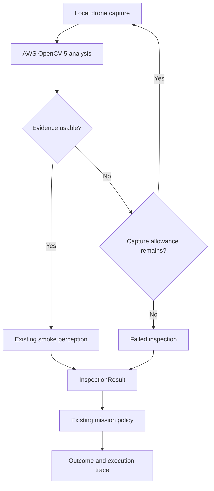

# Week 7 — OpenCV 5 Analysis and AWS Integration

## Objective

Extend the local inspection system completed in Week 6 with a useful OpenCV 5 analysis capability and a meaningful running component on AWS.

By the end of the core Week 7 milestone, a live inspection should send newly captured drone evidence to an AWS-hosted analysis component, use its response in the inspection workflow, and preserve the analysis, mission outcome, and execution details for review.

The Week 7 milestone is:

> **New drone evidence is analyzed with OpenCV 5 on AWS, and that analysis influences the inspection workflow.**

This milestone has two required parts:

1. Establish a useful, reproducible OpenCV 5 workload locally.
2. Deploy and integrate that workload on AWS.

A thin agent layer is a conditional extension after those parts work. It must not delay the required analysis, deployment, or submission preparation.

“Week” continues to name a work milestone rather than a required seven-day duration.

---

## Week 6 Closeout — October 13, 2026

Week 6's functional milestone has been demonstrated.

The project can now:

- accept a monitoring event and create an inspection request;
- dispatch the drone to a predefined region and confirm arrival;
- capture, save, and analyze new drone imagery;
- produce a validated `InspectionResult`;
- apply a deterministic decision policy;
- produce a validated `MissionOutcome`;
- record outcomes and local human-review requests;
- preserve the request, observation, evidence, and outcome in a JSON trace;
- record cleanup errors separately;
- return home, land, shut down, and disconnect;
- preserve an underlying inspection failure after recording its review outcome.

### Verified Live Run

| Item | Recorded result |
| --- | --- |
| Inspection ID | `inspection_ca214340` |
| Monitoring trigger | Synthetic `MonitoringEvent` |
| Inspection evidence | Actual Project AirSim `DownCamera` imagery |
| Requested NED target | `(5.0, 10.0, -5.0)` |
| Actual position, rounded | `(5.02, 9.98, -5.55)` |
| Arrival tolerance | `1.0` meter per axis |
| Inspection completed | `True` |
| Smoke reported | `True` |
| Model confidence | Approximately `0.690` |
| Mission decision | `request_human_review` |
| Mission reason | `smoke_observed` |
| Cleanup | Return-home, landing, and disconnect completed |
| Trace review | User confirmed the saved JSON was correct |

Evidence:

- PNG: `data/test_outputs/inspections/inspection_320a0531213249e29fc75d19b49d91e3_rgb.png`
- Trace: `data/test_outputs/inspections/inspection_ca214340_trace.json`

The controlled suite passed all 15 tests, including positive, negative, failed-inspection, malformed-input, provenance, and cleanup cases.

The live scene contained no intended smoke event. Retain this run and the Week 5 run as known false-positive evidence. Correct mission handling does not establish detector accuracy.

Week 6 changes are associated with PR #10. This document records functional closeout without assuming that the PR has already been merged.

---

## Why This Phase Matters

The [official competition overview](https://opencv26.devpost.com/) requires:

- substantive OpenCV 5 image or video analysis;
- a meaningful component running on AWS.

The existing simulator and Roboflow flow establishes a working prototype, but it does not complete those requirements.

For the optional Agentic Vision path, visual results must influence a subsequent plan, tool call, action, or request for human approval. The existing deterministic mission policy is a useful foundation, but it does not by itself establish an agent workflow.

These requirements were checked on October 13, 2026. Recheck the official overview and [rules](https://opencv26.devpost.com/rules) during final submission preparation.

---

## Week 7 Scope and Order

Work through the phase sequentially.

| Stage | Priority | Exit condition |
| --- | --- | --- |
| 7A — Local OpenCV 5 analysis | Required | Useful analysis runs reproducibly and influences inspection behavior |
| 7B — AWS deployment | Required | The same workload runs remotely and returns structured results |
| 7C — Live integration | Required | Actual drone evidence passes through the cloud analysis and mission flow |
| 7D — Thin agent layer | Conditional | Visual evidence changes a subsequent agent action, with a reviewable trace |

Do not begin cloud deployment before the local workload is defined and working.

Do not begin the agent layer before the cloud-backed inspection path works.

---

## System Boundary

The simulator and drone control remain local. The analysis component runs on AWS.

This diagram shows the proposed evidence-quality workload described below. Finalize that choice during Stage 7A before treating its behavior as an implemented contract.

The cloud component does not control the drone or choose a dangerous-fire classification.

Return-home, landing, shutdown, and disconnect remain caller-owned.

---

## Goal 1 — Define One Useful OpenCV 5 Workload

Choose one bounded image-analysis task whose output changes inspection behavior.

### Initial Proposal: Evidence-Quality Analysis

Analyze the captured image to determine whether it is suitable for the next inspection step.

Candidate measurements include:

- focus or blur;
- excessive darkness or brightness;
- the proportion of pixels affected by exposure problems.

The purpose is to avoid treating unusable evidence as a reliable observation.

A proposed response is:

| Analysis result | Inspection behavior |
| --- | --- |
| Evidence usable | Continue to the existing smoke detector |
| Evidence unusable and another capture is allowed | Request one additional fresh capture |
| Evidence still unusable after the allowed capture | Produce a failed inspection and request human review |
| Analysis unavailable or failed | Preserve uncertainty and produce a failed inspection |

The initial capture allowance should be bounded: one initial capture and at most one additional capture. No search sweeps or autonomous flight repositioning are required.

### Selection Checkpoint

Before implementation, document:

1. The visual problem the analysis addresses.
2. The OpenCV operations performing the analysis.
3. The measurements returned.
4. The workflow behavior those measurements influence.
5. How usable and unusable evidence will be checked.

Evidence-quality analysis is a proposal, not an established competition-eligibility determination. Assess whether it provides sufficient substance and practical value. If it does not, select a better bounded workload before deployment begins.

Do not expand into several unrelated analysis features.

### Interpretation Rules

- Image usability is separate from smoke presence.
- A usable image does not establish that the detector is correct.
- An unusable image must not become a negative smoke result.
- Quality measurements must not be presented as evidence of a dangerous fire.
- Do not choose quality thresholds specifically to suppress the known false positives.

Image encoding, resizing, annotation, and version reporting alone are not the intended analysis contribution.

---

## Goal 2 — Establish a Reproducible OpenCV 5 Environment

Verify an actual OpenCV 5 runtime for the selected workload.

Record:

- the reported OpenCV version;
- the package, build, or installation source;
- pinned dependencies;
- the commands needed to reproduce the environment;
- the analysis input and expected output.

First confirm that the installation approach supports the selected operations. Do not assume the current OpenCV 4.12 dependency can be replaced without compatibility work.

The analysis component may use its own environment. The working Windows simulator client does not need to migrate at the same time.

### Local Verification

Use a small collection of representative images and clearly labeled controlled variants.

For evidence-quality analysis, include:

- a usable image;
- a deliberately blurred image;
- an image with deliberately poor exposure;
- invalid or undecodable input.

These checks establish the analysis behavior. They do not establish smoke-model accuracy.

Finish this stage with a local command that performs the workload and returns a structured result.

---

## Goal 3 — Define the Analysis Contract

Introduce a small project-owned analysis result and a boundary that can support both local and remote execution.

For the proposed quality workload, the initial result should distinguish:

- analysis completed with usable evidence;
- analysis completed with unusable evidence;
- analysis failed or was unavailable.

Suggested information:

| Information | Purpose |
| --- | --- |
| Inspection association | Link analysis to the current request and evidence |
| Execution status | Distinguish completed analysis from operational failure |
| Usability result | Report usable, unusable, or unknown |
| Measurements | Preserve the values used to interpret image quality |
| OpenCV version | Identify the runtime that performed the workload |
| Error description | Explain analysis failure when present |

Finalize field names and validation during implementation. These are proposed contract requirements, not existing interfaces.

Keep the result small. Preserve deployment details and timing in the execution trace rather than duplicating every field across payloads.

### Preserve Existing Mission Semantics

The current `MissionOutcome` decisions and reasons remain sufficient:

- usable evidence proceeds to normal smoke inspection;
- successful smoke inspection follows the existing positive or negative policy;
- exhausted unusable evidence or an analysis failure produces a failed `InspectionResult`;
- failed inspection requests review for `inspection_failed`.

No new danger classification or notification status is required.

---

## Goal 4 — Deploy the Workload on AWS

Run the verified analysis component on AWS and expose a callable boundary.

The deployment must perform the actual OpenCV 5 workload. Cloud storage alone is not the intended AWS contribution.

### Minimum Deployment Behavior

The component should:

1. Receive an inspection image and its association.
2. Decode and validate the input.
3. Execute the selected OpenCV 5 analysis.
4. Return a structured result.
5. Expose enough execution information to verify the deployed version and investigate failures.

Choose the simplest deployment that supports the verified runtime and can be reproduced within the schedule. Select the AWS service after resolving packaging requirements.

A container may be useful if it keeps the local and deployed analysis environments consistent, but containerization is an implementation choice rather than a separate feature milestone.

### Deployment Evidence

Retain:

- deployment instructions;
- dependency and runtime versions;
- configuration needed to reproduce the service;
- one successful remote request and response;
- relevant cloud execution logs;
- basic request latency measurements;
- instructions for stopping resources after the demonstration.

Keep credentials out of source code and traces. Use bounded requests and an explicit timeout.

---

## Goal 5 — Integrate the Cloud Analysis into Inspection

Extend the current mission without moving Project AirSim into AWS.

The integrated flow should:

1. Create the synthetic monitoring event and inspection request.
2. Dispatch the drone and confirm arrival.
3. Capture and save fresh evidence.
4. Submit that evidence for AWS-hosted OpenCV 5 analysis.
5. Use the returned analysis to determine the next inspection step.
6. Produce `InspectionResult`.
7. Apply the existing mission policy.
8. Save the analysis, outcome, evidence association, and execution details.
9. Return home, land, shut down, and disconnect.

For the quality-analysis proposal, smoke perception must operate on the selected usable evidence. Any rejected captures should remain associated with their analysis records.

### Failure Handling

Handle explicitly:

- invalid input;
- analysis timeout;
- unavailable service;
- malformed or inconsistent response;
- unusable evidence after the permitted capture;
- smoke-perception failure;
- cleanup failure.

Do not silently substitute a negative detection when cloud analysis fails.

Do not silently fall back to local analysis in the cloud demonstration. If a local mode exists for development, identify it explicitly in the trace.

Preserve available evidence and the underlying error. Continue to attempt flight cleanup.

---

## Goal 6 — Collect Initial Evaluation Evidence

Verify behavior before expanding the system.

| Case | Expected behavior |
| --- | --- |
| Usable evidence | Analysis permits the next inspection step |
| Unusable evidence | Workflow changes according to the bounded capture policy |
| Repeated unusable evidence | Failed inspection requests review |
| Cloud timeout or unavailable service | Failure remains explicit; cleanup still runs |
| Malformed analysis response | Response is rejected |
| Smoke-perception failure | Evidence and failure association remain available |
| Successful live mission | Cloud analysis, inspection, outcome, and cleanup are linked |

Use controlled inputs for branches that are difficult to produce reliably in the simulator.

Then run at least one mission using actual drone evidence and the deployed analysis component.

Record separate measures for:

- analysis execution success;
- remote request latency;
- resulting workflow behavior;
- inspection completion;
- cleanup completion.

Keep those measures separate from perception correctness.

Retain the Week 5 and Week 6 false positives. Do not report synthetic checks as live detection results.

---

## Conditional Goal — Add a Thin Agent Layer

Begin this only after the required OpenCV 5 and AWS path works.

The agent should use the existing capabilities through a small tool boundary. MCP is an option, not a prerequisite.

For the initial proposal, a meaningful agent action could be:

- inspect the analysis result;
- request an allowed additional capture when evidence is unusable;
- continue analysis or record uncertainty based on the new evidence.

The agent must actually choose and invoke a subsequent action from visual evidence. Summarizing a predetermined result or renaming a fixed script as an agent is insufficient.

Keep action limits, input validation, deterministic outcome handling, and flight cleanup enforced by project code.

### Agent Evidence

If implemented, retain:

- the available tools and their responsibilities;
- a workflow diagram;
- a trace showing visual output changing a later tool call or action;
- one failure case demonstrating bounded behavior and appropriate human review.

If this extension is deferred, document that status clearly. Completing the core Week 7 milestone does not establish Agentic Vision eligibility.

---

## Definition of Done — Core Week 7

- [ ] One bounded OpenCV 5 workload is selected and justified.
- [ ] The actual OpenCV 5 runtime is verified and reproducible.
- [ ] The workload performs useful image analysis.
- [ ] Analysis output influences inspection behavior.
- [ ] Analysis success, unusable evidence, and operational failure remain distinct.
- [ ] The analysis contract is validated and serializable.
- [ ] The workload runs on AWS.
- [ ] Deployment and invocation instructions are reproducible.
- [ ] A live mission submits actual drone evidence to the deployed component.
- [ ] The returned analysis influences the live workflow.
- [ ] Analysis, evidence, inspection, and outcome remain linked in the trace.
- [ ] Controlled success and failure checks pass.
- [ ] Remote failures remain explicit and preserve uncertainty.
- [ ] Return-home, landing, and cleanup remain verified.
- [ ] Initial timing and execution measurements are recorded.
- [ ] Interface and architecture documentation reflect the implementation.
- [ ] Known perception limitations and false-positive evidence are retained.

### Conditional Agent Completion

- [ ] A real agent invokes the project capabilities.
- [ ] Visual analysis changes a later agent action.
- [ ] Action limits and human-review boundaries remain enforced.
- [ ] A reviewable agent trace and failure example are retained.

The conditional checklist is required only if the agent extension is pursued.

---

## Expected Source Organization

| Path | Responsibility |
| --- | --- |
| `src/analysis/` | Project-owned analysis contracts and local client boundary |
| `services/evidence_analysis/` | Deployable OpenCV 5 workload |
| `deployment/` | Reproducible AWS deployment configuration |
| `src/inspection/inspector.py` | Integration with evidence acquisition and inspection |
| `src/mission/` | Existing deterministic outcome handling |
| `scripts/` | Controlled analysis checks and live integration entry points |
| `docs/interfaces.md` | Implemented payload and service contracts |
| `docs/architecture.md` | Local/cloud responsibilities |
| `docs/evaluation.md` | Measurements, cases, and known limitations |

Paths are suggested organization, not instructions to create empty scaffolding. Final filenames should follow the chosen implementation.

---

## Explicit Non-Goals

### No Expanded Simulation

Continue with Blocks, one predefined region, and one drone.

Do not add the full property, all three monitoring cameras, world localization, search sweeps, or autonomous flight viewpoint selection.

### No Detector Training Project

Do not train a model, build a large dataset, or begin extensive threshold optimization.

Evidence-quality analysis must not be presented as a solution to smoke-model false positives without evaluation supporting that claim.

### No Campfire/Dangerous-Fire Classification

Continue to describe the detector output as a smoke observation.

Human review remains the response to positive observations and unresolved inspection failures.

### No New Product Surface

Do not build a dashboard, user account system, mobile app, or external notification system.

A callable analysis component and the current local review record are sufficient for this phase.

### No Unnecessary Cloud Expansion

Do not move the simulator into AWS or introduce multiple services without a demonstrated need.

A generalized evidence store, database, or fleet-management system is outside this milestone.

### No Unbounded Agent Behavior

Do not let the agent invent flight targets, bypass the mission policy, or continue capturing indefinitely.

---

## Calendar Targets and Scope Checkpoint

| Target | Deliverable |
| --- | --- |
| October 13–15 | Select the workload and establish reproducible local OpenCV 5 analysis |
| October 16–18 | Deploy the analysis component on AWS |
| October 19–20 | Complete live integration and assess the bounded agent extension |
| October 21–23 | Evaluate the final system, collect measurements, and freeze features |
| October 24–25 | Finish report, architecture, instructions, and demonstration video |
| October 25 | Internal submission target |
| October 26 | Published competition deadline, Pacific time |

The first three rows are planning targets, not reasons to delay work that is ready earlier.

### October 20 Checkpoint

If the OpenCV 5/AWS path is not working by October 20:

- defer the agent extension;
- focus on completing the required analysis and deployment;
- reduce scope within the existing prototype;
- preserve the evaluation and packaging window.

Do not add new features during the final preparation window to compensate for incomplete evidence or documentation.

---

## First Working Session

Start with Stage 7A:

1. Confirm the intended visual-analysis task and its workflow effect.
2. Verify a reproducible OpenCV 5 environment for that task.
3. Run the analysis on a saved inspection image.
4. Check one clearly usable and one deliberately unusable input.
5. Review the results before choosing the AWS deployment.

This is the immediate next step. Cloud deployment and agent integration follow once this foundation works.

---

## Week 7 Guiding Question

> **Does this work establish useful OpenCV 5 analysis on AWS, with a visible effect on inspection and reviewable evidence?**

If not, keep it outside the core milestone and assess it against the remaining submission schedule.